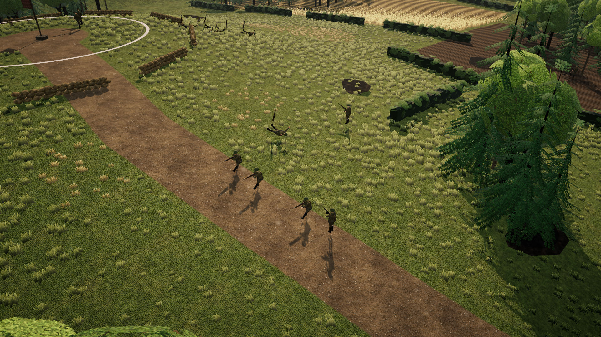
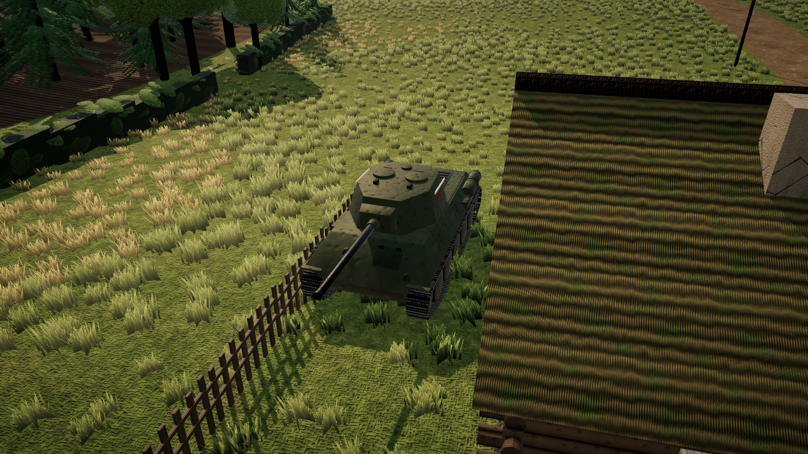
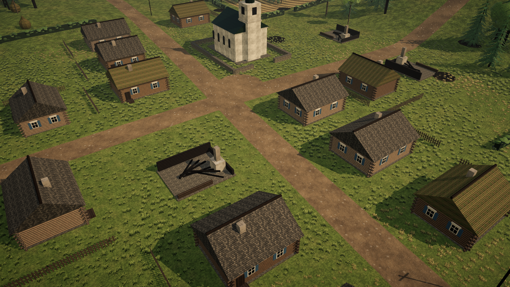

# Real Peace

Тактическая стратегия в реальном времени с активной паузой о Восточном фронте 1943 года — **Битва за Токмачку**. Игрок выбирает
сторону — **СССР** или **Германия** — и командует пехотой, пулемётными и противотанковыми расчётами и танками
в битве за Токмачку (Запорожье, осень 1943).

| | |
|---|---|
|  |  |

## Что есть

- Две карты:
  - **Битва за Токмачку** — село с церковью, мельница за рекой, высота 112; три точки.
  - **Бои за Мелитополь** — город, вокзал и железная дорога, элеватор, кладбище, курган, река Молочная; пять точек, бой дольше.
- Войска: стрелки, пулемётчики, ПТ-расчёты, Т-34-76 и Pz.IV, миномёты, снайперы, штурмовые сапёры с огнемётами.
- Точки контроля и очки победы, живая сила и подкрепления.
- Укрытия, подавление пулемётным огнём, броня танков по сторонам (лоб/борт/корма), гранаты, туман войны.
- ИИ противника: захват точек, оборона, отвод потрёпанных отрядов, охота на танки.
- Активная пауза: приказы и маршруты (Shift+ПКМ) можно отдавать на паузе.
- Графика: URP и свои шейдеры (земля из пяти слоёв, трава и пшеница с ветром, вода, листва, частицы),
  танки и солдаты смоделированы скриптами в Blender.

## Как запустить

**Готовая игра (Mac):** скачайте `RealPeace-mac.zip` в разделе [Releases](../../releases), распакуйте и при первом
запуске откройте `Real Peace.app` правой кнопкой → «Открыть» (приложение не подписано Apple).

**Из исходников:** Unity 6000.3.25f1. Откройте папку проекта в Unity Hub и нажмите Play — сцена `Battle`
откроется сама.

## Управление

| | |
|---|---|
| WASD / стрелки / край экрана | камера |
| Q / E, средняя кнопка мыши | поворот камеры |
| Колесо | приближение |
| ЛКМ, рамка | выделение (Shift — добавить, двойной клик — все такие же) |
| ПКМ | идти / атаковать |
| Shift + ПКМ | добавить точку маршрута |
| F + ПКМ или Ctrl + ПКМ | движение с атакой |
| X / R | стоп / отступить на базу |
| Ctrl + 1…9, 1…9 | группы |
| Пробел | пауза |
| + / − | скорость |
| F5–F11 | подкрепления |
| F1 | справка |

## Устройство проекта

Весь мир строится кодом при запуске (`Assets/Scripts`), шейдеры — в `Assets/Shaders`, модели из Blender —
`Assets/Resources/Models` (исходные скрипты — `Tools/Blender`). Подробности — в [CLAUDE.md](CLAUDE.md).
